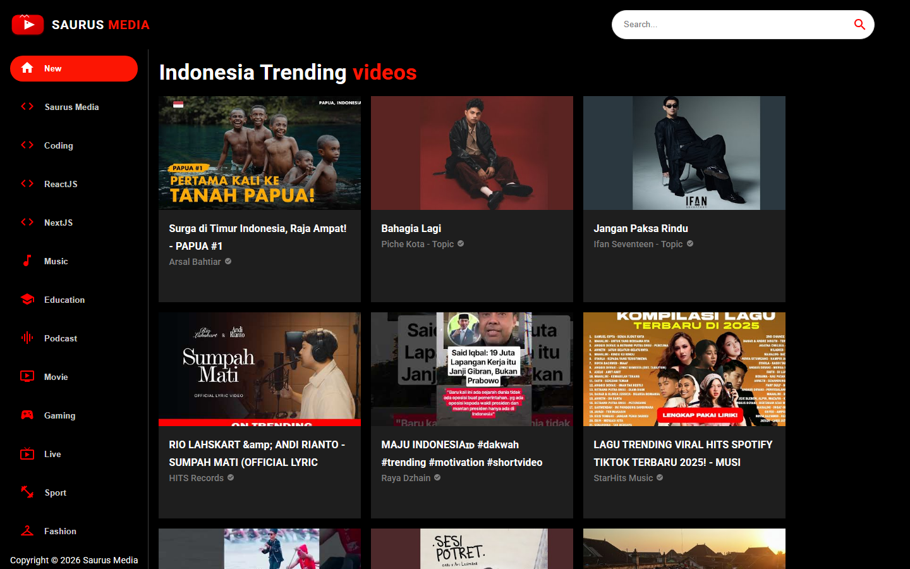
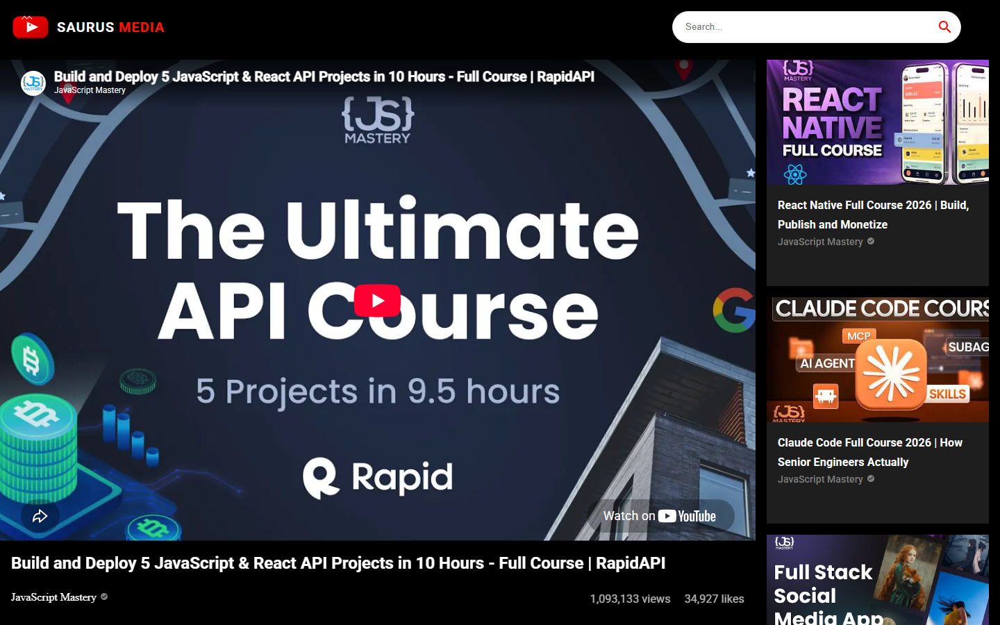
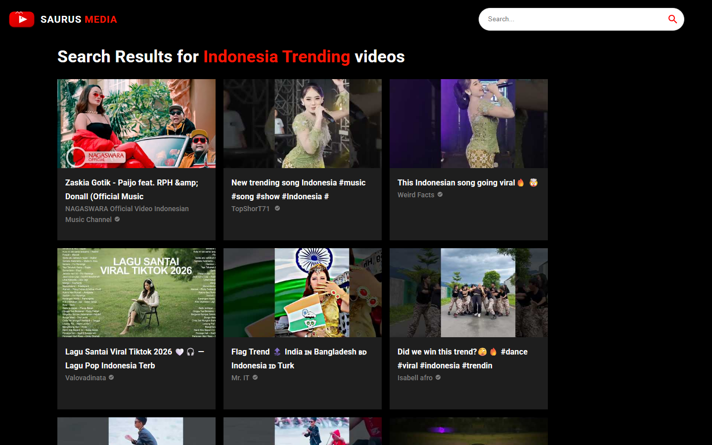

# 🦖 Saurus Media — Modern YouTube Clone Application

<p align="center">
  
</p>

<p align="center">
  
  
  
  
</p>

---

## 📖 Overview

**Saurus Media** is a modern, responsive YouTube Clone video streaming web application built with **React 18**, **Material UI 5**, and powered by the **RapidAPI YouTube v3** engine. 

Features seamless video search, channel exploration, dynamic category filtering, dedicated video playback pages with suggested recommendations, and a dedicated **Indonesian Trending** feed on the home page.

---

## ✨ Features

- **🇮🇩 Localized Indonesian Trending Feed**: The home feed automatically fetches the latest trending videos, music, and creator content across Indonesia.
- **🦖 Custom Saurus Media Branding**: Clean dark-themed aesthetic with a custom vector SVG logo and cohesive typography.
- **🔍 Global Search Bar**: Search for any video, topic, or creator worldwide in real time.
- **📑 Multi-Category Navigation**: Quick filtering across categories: *Saurus Media, Coding, ReactJS, NextJS, Music, Education, Podcast, Gaming, and more*.
- **▶️ Immersive Video Player**: Video playback powered by `react-player` with view counts, like statistics, creator details, and related video suggestions.
- **📱 Responsive Design**: Seamless viewing experience across desktop, tablet, and mobile displays.

---

## 📸 Screenshots Showcase

### 1. 🏠 Home Page (Indonesia Trending Feed)


### 2. 🎬 Video Player & Related Videos


### 3. 🔎 Search Results


---

## 🛠️ Tech Stack

| Technology | Purpose |
|---|---|
| **[React 18](https://react.dev/)** | Core Frontend UI Library |
| **[Material UI v5](https://mui.com/)** | Component Library & Iconography |
| **[React Router DOM v6](https://reactrouter.com/)** | Client-Side Routing |
| **[React Player](https://github.com/cookpete/react-player)** | Embedded Video Playback |
| **[Axios](https://axios-http.com/)** | HTTP Client for API Requests |
| **[RapidAPI (YouTube v3)](https://rapidapi.com/)** | Live YouTube Data Fetching |

---

## 📂 Project Structure

```bash
project_youtube_clone/
├── assets/                  # High-resolution showcase screenshots
│   ├── home_desktop.png
│   ├── search_preview.png
│   └── video_player.png
├── public/                  # Public static assets & templates
│   ├── index.html           # Document root template
│   └── saurus-logo.svg      # Saurus Media vector SVG brand logo
├── src/
│   ├── components/          # Reusable UI components
│   │   ├── ChannelCard.jsx  # Channel thumbnail card
│   │   ├── ChannelDetail.jsx# Channel profile & video listing
│   │   ├── Feed.jsx         # Main video feed & category router
│   │   ├── Navbar.jsx       # Header navigation & search bar
│   │   ├── SearchBar.jsx    # Live search input component
│   │   ├── SearchFeed.jsx   # Search query results page
│   │   ├── Sidebar.jsx      # Category navigation sidebar
│   │   ├── VideoCard.jsx    # Video card with thumbnail & stats
│   │   ├── VideoDetail.jsx  # Dedicated video player view
│   │   └── Videos.jsx       # Grid list wrapper for video items
│   ├── utils/
│   │   ├── constants.js     # Branding, categories & fallback data
│   │   └── fetchFromAPI.js  # RapidAPI Axios configuration
│   ├── App.js               # Root application router
│   ├── index.css            # Base design & scrollbar utilities
│   └── index.js             # React DOM entry point
├── .env                     # Environment variables (API Key & Port)
└── package.json
```

---

## 🚀 Getting Started

Follow these steps to run the application locally:

### 1. Clone the Repository
```bash
git clone https://github.com/adrianhajdin/project_youtube_clone.git
cd project_youtube_clone
```

### 2. Configure Environment Variables
Create a `.env` file in the root directory:
```env
REACT_APP_RAPID_API_KEY=YOUR_RAPIDAPI_KEY_HERE
PORT=4000
```
> [!NOTE]
> You can obtain a free API key by subscribing to the [YouTube v3 API on RapidAPI](https://rapidapi.com/ytdl-org-ytdl-org-default/api/youtube-v31).

### 3. Install Dependencies
```bash
npm install --legacy-peer-deps
```

### 4. Start Development Server
```bash
npm start
```

Open [http://localhost:4000](http://localhost:4000) in your browser to view the application!

---

## 📄 License

This project is licensed under the [MIT License](LICENSE).
